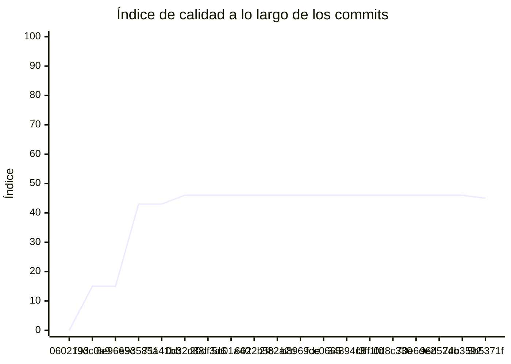

<!-- evaluacion:inicio -->
# Evaluación — Final-Programacion-II/turnos-catalog-service

> Documento **generado automáticamente** por la cátedra de Programación II (UM): RepoSense + análisis de calidad de **7 dimensiones**. **No editar a mano**: se regenera en cada evaluación.
> Rama evaluada: `main`. Análisis **heurístico** (regex + métricas) + build: es una criba para orientar la revisión, **no una nota**. La **documentación** del repositorio no se evalúa.
> Generado: 2026-11-18.

## 1. Veredicto

| Aspecto | Resultado |
|---|---|
| Índice de calidad | **56/100** |
| Tipo de repositorio | `backend` |
| Build (`mvnw verify` / `gradlew check`) | OK |
| Código (LOC) | 6,471 |
| Archivos de código | 135 |
| Clases | 144 |
| Código dentro de clases (%POO) | 78% |
| Funciones fuera de clases | 0 |
| Duplicación (puerta) | 4.3% |
| Duplicación lógica | 4.6% |
| Duplicación de boilerplate | 11.2% |
| Cobertura | 76% |
| Tope duro aplicado a D1 | `POO_BAJO` → D1 ≤ 60 |

> Este informe **describe** lo que el análisis midió con los criterios ya establecidos de la materia. No es una nota.

## 2. Semáforo de aprobación

Criterios de la cátedra (`CRITERIOS-CALIDAD.md`): **Aprobar** se juega con el perfil `estandar`; **destacar**, con el `exigente` (meta de excelencia).

| Semáforo | Resultado |
|---|---|
| Aprobar (`estandar`) | **no cumple** — 5/11 |
| Destacar (`exigente`) | **no cumple** — 4/11 |

**Para aprobar, falta cumplir:** SOLID; Hexagonal; Duplicación

**Para destacar, falta cumplir:** SOLID; POO; Hexagonal; Duplicación

## 3. Autoría (RepoSense)

| Autor | Commits | Código (LOC) | Tests (LOC) | Docs (LOC) | Días activos | % del código |
|---|---:|---:|---:|---:|---:|---:|
| Facundo Mangione | 33 | 4,041 | 3,996 | 2,127 | 24 | 100% |

> _El LOC de autoría lo calcula RepoSense sobre el historial y puede diferir del LOC de código del análisis (que mira el estado de `main`)._

## 4. Dimensiones evaluadas

Cada dimensión indica **qué mide**, **por qué importa** y **tu resultado**. Cuando el puntaje queda por debajo de la referencia, se agregan preguntas para **investigar la causa** (no hay recetas).

| Dimensión | Peso | Puntaje |
|:--|--:|--:|
| **D1** Diseño OO, SOLID y patrones (20%) | 20% | 4 |
| **D2** Arquitectura hexagonal — backend (15%) | 15% | 0 |
| **D3** Frontend KMP: MVVM y buenas prácticas (10%) | 10% | N/A |
| **D4** Integración y contrato (10%) | 10% | 80 |
| **D5** Seguridad y robustez (10%) | 10% | 100 |
| **D6** Pruebas y cobertura (20%) | 20% | 100 |
| **D7** Proceso y entrega (15%) | 15% | 77 |

### D1. Diseño OO, SOLID y patrones (20%)

- **Qué mide:** Métricas orientadas a objetos (clases, métodos, campos, cohesión, acoplamiento, herencia) y proxies de SOLID, más patrones de diseño.
- **Por qué importa:** El eje de la materia es el buen uso de la POO y su arquitectura: un diseño con clases claras y poco acopladas es más fácil de entender, probar y cambiar.
- **Tu resultado:** **4/100**
- **Para investigar la causa:**
    - ¿Se pensó el modelo de clases antes de codificar o se agrupó después?
    - ¿Qué clases concentran muchas responsabilidades a la vez?
    - ¿Los colaboradores llegan como parámetros o se crean por dentro?

### D2. Arquitectura hexagonal — backend (15%)

- **Qué mide:** Separación en capas (dominio, puertos de entrada/salida, adaptadores) y dirección de las dependencias del backend.
- **Por qué importa:** Aislar el dominio de la infraestructura permite cambiar la base de datos, el framework o el transporte sin tocar las reglas de negocio.
- **Tu resultado:** **0/100**
- **Para investigar la causa:**
    - ¿El dominio importa framework o detalles de persistencia?
    - ¿Dónde vive la lógica de negocio frente a los controladores?
    - ¿Se definieron puertos para los servicios que se consumen?

### D4. Integración y contrato (10%)

- **Qué mide:** Cumplimiento del contrato de integración de la cátedra (formato de errores, paginación, autenticación, endpoints esperados).
- **Por qué importa:** Los servicios deben poder integrarse entre sí y con la app sin sorpresas; el contrato es lo que hacen cumplir las pruebas de integración.
- **Tu resultado:** **80/100**

### D5. Seguridad y robustez (10%)

- **Qué mide:** Credenciales embebidas, consultas SQL por concatenación, y presencia de config de entorno; aislamiento de secretos.
- **Por qué importa:** Un secreto en el repositorio o una consulta construida por concatenación son riesgos concretos, no hipotéticos.
- **Tu resultado:** **100/100**

### D6. Pruebas y cobertura (20%)

- **Qué mide:** Cantidad y resultado de pruebas y cobertura de línea (JaCoCo/Kover, Surefire/Failsafe) cuando hay build.
- **Por qué importa:** Las pruebas son la red de seguridad para refactorizar e integrar; la cobertura acota las zonas sin verificar.
- **Tu resultado:** **100/100**

### D7. Proceso y entrega (15%)

- **Qué mide:** Artefactos verificables de proceso/entrega: `compose`, `.env.example`, CI (`.github/workflows/`), `CODEOWNERS` y wrapper de build (`mvnw`/`gradlew`). **No** puntúa documentación.
- **Por qué importa:** Un proyecto que compila, se levanta y se valida solo es más fácil de revisar y de integrar en equipo.
- **Tu resultado:** **77/100**

## 5. Señales detectadas

El análisis encontró las siguientes señales, con el archivo y la línea donde se originan cuando están disponibles:

**Archivos con más señales**

| Archivo | Señales |
|---|---:|
| `src/main/java/ar/edu/um/turnos/catalog/domain/WeeklySchedule.java` | 14 |
| `src/main/java/ar/edu/um/turnos/catalog/domain/AbstractAuditingEntity.java` | 10 |
| `src/main/java/ar/edu/um/turnos/catalog/sync/domain/CatalogSnapshot.java` | 9 |
| `src/main/java/ar/edu/um/turnos/catalog/sync/infrastructure/catedra/CatalogSnapshotResponse.java` | 7 |
| `src/main/java/ar/edu/um/turnos/catalog/web/rest/errors/ExceptionTranslator.java` | 7 |
| `src/main/java/ar/edu/um/turnos/catalog/security/SecurityUtils.java` | 5 |
| `src/main/java/ar/edu/um/turnos/catalog/domain/ProfessionalCategory.java` | 5 |
| `src/main/java/ar/edu/um/turnos/catalog/domain/Professional.java` | 5 |
| `src/main/java/ar/edu/um/turnos/catalog/web/rest/AccountResource.java` | 5 |
| `src/main/java/ar/edu/um/turnos/catalog/sync/infrastructure/persistence/JpaCatalogReplica.java` | 4 |

**DIP/concretos** (31)
- clase 'CatalogApp' muy acoplada (CBO=24) — `src/main/java/ar/edu/um/turnos/catalog/CatalogApp.java:24`
- clase 'LoggingAspect' muy acoplada (CBO=24) — `src/main/java/ar/edu/um/turnos/catalog/aop/logging/LoggingAspect.java:22`
- clase 'AsyncConfiguration' muy acoplada (CBO=12) — `src/main/java/ar/edu/um/turnos/catalog/config/AsyncConfiguration.java:22`
- clase 'AsyncConfiguration' instancia 3 concretos (CBO=12) — `src/main/java/ar/edu/um/turnos/catalog/config/AsyncConfiguration.java:22`
- clase 'CRLFLogConverter' muy acoplada (CBO=16) — `src/main/java/ar/edu/um/turnos/catalog/config/CRLFLogConverter.java:23`
- clase 'LiquibaseConfiguration' muy acoplada (CBO=18) — `src/main/java/ar/edu/um/turnos/catalog/config/LiquibaseConfiguration.java:22`
- clase 'SecurityConfiguration' muy acoplada (CBO=11) — `src/main/java/ar/edu/um/turnos/catalog/config/SecurityConfiguration.java:19`
- clase 'SecurityJwtConfiguration' muy acoplada (CBO=19) — `src/main/java/ar/edu/um/turnos/catalog/config/SecurityJwtConfiguration.java:21`
- clase 'WebConfigurer' muy acoplada (CBO=13) — `src/main/java/ar/edu/um/turnos/catalog/config/WebConfigurer.java:21`
- clase 'WeeklySchedule' muy acoplada (CBO=15) — `src/main/java/ar/edu/um/turnos/catalog/domain/WeeklySchedule.java:20`
- clase 'SecurityUtils' muy acoplada (CBO=28) — `src/main/java/ar/edu/um/turnos/catalog/security/SecurityUtils.java:21`
- clase 'ProfessionalAgendaService' muy acoplada (CBO=12) — `src/main/java/ar/edu/um/turnos/catalog/service/ProfessionalAgendaService.java:21`
- clase 'ProfessionalService' muy acoplada (CBO=22) — `src/main/java/ar/edu/um/turnos/catalog/service/ProfessionalService.java:25`
- clase 'CatalogSyncService' muy acoplada (CBO=11) — `src/main/java/ar/edu/um/turnos/catalog/sync/application/CatalogSyncService.java:12`
- clase 'CatedraRestAdapter' muy acoplada (CBO=16) — `src/main/java/ar/edu/um/turnos/catalog/sync/infrastructure/catedra/CatedraRestAdapter.java:14`
- clase 'CatedraRestAdapter' instancia 3 concretos (CBO=16) — `src/main/java/ar/edu/um/turnos/catalog/sync/infrastructure/catedra/CatedraRestAdapter.java:14`
- clase 'CatalogUpdatedListener' muy acoplada (CBO=13) — `src/main/java/ar/edu/um/turnos/catalog/sync/infrastructure/kafka/CatalogUpdatedListener.java:12`
- clase 'JpaCatalogReplica' muy acoplada (CBO=25) — `src/main/java/ar/edu/um/turnos/catalog/sync/infrastructure/persistence/JpaCatalogReplica.java:29`
- clase 'JpaCatalogReplica' instancia 6 concretos (CBO=25) — `src/main/java/ar/edu/um/turnos/catalog/sync/infrastructure/persistence/JpaCatalogReplica.java:29`
- clase 'RedisCatalogChangeSource' muy acoplada (CBO=19) — `src/main/java/ar/edu/um/turnos/catalog/sync/infrastructure/redis/RedisCatalogChangeSource.java:18`
- clase 'RedisCatalogChangeSource' instancia 5 concretos (CBO=19) — `src/main/java/ar/edu/um/turnos/catalog/sync/infrastructure/redis/RedisCatalogChangeSource.java:18`
- clase 'AccountResource' muy acoplada (CBO=16) — `src/main/java/ar/edu/um/turnos/catalog/web/rest/AccountResource.java:21`
- clase 'AccountResource' instancia 3 concretos (CBO=16) — `src/main/java/ar/edu/um/turnos/catalog/web/rest/AccountResource.java:21`
- clase 'AuthenticateController' muy acoplada (CBO=12) — `src/main/java/ar/edu/um/turnos/catalog/web/rest/AuthenticateController.java:19`
- clase 'CatalogSyncStatusResource' muy acoplada (CBO=8) — `src/main/java/ar/edu/um/turnos/catalog/web/rest/CatalogSyncStatusResource.java:16`
- clase 'ProfessionalAgendaResource' muy acoplada (CBO=9) — `src/main/java/ar/edu/um/turnos/catalog/web/rest/ProfessionalAgendaResource.java:19`
- clase 'ProfessionalCategoryResource' muy acoplada (CBO=15) — `src/main/java/ar/edu/um/turnos/catalog/web/rest/ProfessionalCategoryResource.java:18`
- clase 'ProfessionalResource' muy acoplada (CBO=18) — `src/main/java/ar/edu/um/turnos/catalog/web/rest/ProfessionalResource.java:21`
- clase 'WeeklyScheduleResource' muy acoplada (CBO=15) — `src/main/java/ar/edu/um/turnos/catalog/web/rest/WeeklyScheduleResource.java:18`
- clase 'BadRequestAlertException' muy acoplada (CBO=8) — `src/main/java/ar/edu/um/turnos/catalog/web/rest/errors/BadRequestAlertException.java:11`
- clase 'ExceptionTranslator' muy acoplada (CBO=60) — `src/main/java/ar/edu/um/turnos/catalog/web/rest/errors/ExceptionTranslator.java:47`

**SRP/responsabilidad** (54)
- método 'CatalogApp.logApplicationStartup' de 35 líneas — `src/main/java/ar/edu/um/turnos/catalog/CatalogApp.java:74`
- clase 'LoggingAspect' grande (LOC=89, métodos=12, campos=1) — `src/main/java/ar/edu/um/turnos/catalog/aop/logging/LoggingAspect.java:22`
- método 'LiquibaseConfiguration.liquibase' de 50 líneas — `src/main/java/ar/edu/um/turnos/catalog/config/LiquibaseConfiguration.java:33`
- clase 'AbstractAuditingEntity' con baja cohesión (14%) — `src/main/java/ar/edu/um/turnos/catalog/domain/AbstractAuditingEntity.java:23`
- clase 'CatalogSyncState' grande (LOC=71, métodos=11, campos=7) — `src/main/java/ar/edu/um/turnos/catalog/domain/CatalogSyncState.java:16`
- clase 'CatalogSyncState' con baja cohesión (24%) — `src/main/java/ar/edu/um/turnos/catalog/domain/CatalogSyncState.java:16`
- clase 'Professional' grande (LOC=138, métodos=27, campos=9) — `src/main/java/ar/edu/um/turnos/catalog/domain/Professional.java:15`
- clase 'Professional' con baja cohesión (13%) — `src/main/java/ar/edu/um/turnos/catalog/domain/Professional.java:15`
- clase 'ProfessionalCategory' grande (LOC=125, métodos=24, campos=8) — `src/main/java/ar/edu/um/turnos/catalog/domain/ProfessionalCategory.java:15`
- clase 'ProfessionalCategory' con baja cohesión (15%) — `src/main/java/ar/edu/um/turnos/catalog/domain/ProfessionalCategory.java:15`
- clase 'WeeklySchedule' grande (LOC=173, métodos=33, campos=11) — `src/main/java/ar/edu/um/turnos/catalog/domain/WeeklySchedule.java:20`
- clase 'WeeklySchedule' con baja cohesión (11%) — `src/main/java/ar/edu/um/turnos/catalog/domain/WeeklySchedule.java:20`
- clase 'SecurityMetersService' grande (LOC=35, métodos=6, campos=8) — `src/main/java/ar/edu/um/turnos/catalog/management/SecurityMetersService.java:8`
- clase 'SecurityMetersService' con baja cohesión (27%) — `src/main/java/ar/edu/um/turnos/catalog/management/SecurityMetersService.java:8`
- clase 'SecurityUtils' grande (LOC=122, métodos=11, campos=2) — `src/main/java/ar/edu/um/turnos/catalog/security/SecurityUtils.java:21`
- método 'SecurityUtils.extractDetailsFromTokenAttributes' de 39 líneas — `src/main/java/ar/edu/um/turnos/catalog/security/SecurityUtils.java:116`
- método 'SecurityUtils.extractDetailsFromTokenAttributes' con complejidad 7 — `src/main/java/ar/edu/um/turnos/catalog/security/SecurityUtils.java:116`
- método 'ProfessionalAgendaService.toAgenda' de 32 líneas — `src/main/java/ar/edu/um/turnos/catalog/service/ProfessionalAgendaService.java:43`
- método 'ProfessionalService.search' con 6 parámetros — `src/main/java/ar/edu/um/turnos/catalog/service/ProfessionalService.java:50`
- método 'CatalogSyncStatusDTO.CatalogSyncStatusDTO' con 5 parámetros — `src/main/java/ar/edu/um/turnos/catalog/service/dto/CatalogSyncStatusDTO.java:9`
- método 'ProfessionalAgendaDTO.ProfessionalAgendaDTO' con 8 parámetros — `src/main/java/ar/edu/um/turnos/catalog/service/dto/ProfessionalAgendaDTO.java:12`
- método 'ProfessionalAgendaDTO.Schedule' con 5 parámetros — `src/main/java/ar/edu/um/turnos/catalog/service/dto/ProfessionalAgendaDTO.java:22`
- método 'Schedule.Schedule' con 5 parámetros — `src/main/java/ar/edu/um/turnos/catalog/service/dto/ProfessionalAgendaDTO.java:22`
- método 'ProfessionalCategoryDTO.ProfessionalCategoryDTO' con 7 parámetros — `src/main/java/ar/edu/um/turnos/catalog/service/dto/ProfessionalCategoryDTO.java:9`
- método 'ProfessionalDTO.ProfessionalDTO' de 32 líneas — `src/main/java/ar/edu/um/turnos/catalog/service/dto/ProfessionalDTO.java:10`
- método 'ProfessionalDTO.ProfessionalDTO' con 8 parámetros — `src/main/java/ar/edu/um/turnos/catalog/service/dto/ProfessionalDTO.java:10`
- método 'WeeklyScheduleDTO.WeeklyScheduleDTO' de 31 líneas — `src/main/java/ar/edu/um/turnos/catalog/service/dto/WeeklyScheduleDTO.java:11`
- método 'WeeklyScheduleDTO.WeeklyScheduleDTO' con 10 parámetros — `src/main/java/ar/edu/um/turnos/catalog/service/dto/WeeklyScheduleDTO.java:11`
- método 'CatalogSnapshot.CatalogSnapshot' de 46 líneas — `src/main/java/ar/edu/um/turnos/catalog/sync/domain/CatalogSnapshot.java:10`
- método 'CatalogSnapshot.CatalogSnapshot' con complejidad 7 — `src/main/java/ar/edu/um/turnos/catalog/sync/domain/CatalogSnapshot.java:10`
- método 'CatalogSnapshot.validateReferences' con complejidad 6 — `src/main/java/ar/edu/um/turnos/catalog/sync/domain/CatalogSnapshot.java:17`
- método 'CatalogSnapshot.Category' con 6 parámetros — `src/main/java/ar/edu/um/turnos/catalog/sync/domain/CatalogSnapshot.java:38`
- método 'Category.Category' con 6 parámetros — `src/main/java/ar/edu/um/turnos/catalog/sync/domain/CatalogSnapshot.java:38`
- método 'CatalogSnapshot.Professional' con 7 parámetros — `src/main/java/ar/edu/um/turnos/catalog/sync/domain/CatalogSnapshot.java:40`
- método 'Professional.Professional' con 7 parámetros — `src/main/java/ar/edu/um/turnos/catalog/sync/domain/CatalogSnapshot.java:40`
- método 'CatalogSnapshot.Schedule' con 9 parámetros — `src/main/java/ar/edu/um/turnos/catalog/sync/domain/CatalogSnapshot.java:50`
- método 'Schedule.Schedule' con 9 parámetros — `src/main/java/ar/edu/um/turnos/catalog/sync/domain/CatalogSnapshot.java:50`
- método 'CatalogSnapshotResponse.CatalogSnapshotResponse' de 65 líneas — `src/main/java/ar/edu/um/turnos/catalog/sync/infrastructure/catedra/CatalogSnapshotResponse.java:11`
- método 'CatalogSnapshotResponse.CategoryItem' con 6 parámetros — `src/main/java/ar/edu/um/turnos/catalog/sync/infrastructure/catedra/CatalogSnapshotResponse.java:36`
- método 'CategoryItem.CategoryItem' con 6 parámetros — `src/main/java/ar/edu/um/turnos/catalog/sync/infrastructure/catedra/CatalogSnapshotResponse.java:36`
- método 'CatalogSnapshotResponse.ProfessionalItem' con 7 parámetros — `src/main/java/ar/edu/um/turnos/catalog/sync/infrastructure/catedra/CatalogSnapshotResponse.java:42`
- método 'ProfessionalItem.ProfessionalItem' con 7 parámetros — `src/main/java/ar/edu/um/turnos/catalog/sync/infrastructure/catedra/CatalogSnapshotResponse.java:42`
- método 'CatalogSnapshotResponse.ScheduleItem' con 9 parámetros — `src/main/java/ar/edu/um/turnos/catalog/sync/infrastructure/catedra/CatalogSnapshotResponse.java:56`
- método 'ScheduleItem.ScheduleItem' con 9 parámetros — `src/main/java/ar/edu/um/turnos/catalog/sync/infrastructure/catedra/CatalogSnapshotResponse.java:56`
- método 'JpaCatalogReplica.save' de 96 líneas — `src/main/java/ar/edu/um/turnos/catalog/sync/infrastructure/persistence/JpaCatalogReplica.java:88`
- método 'JpaCatalogReplica.save' con complejidad 19 — `src/main/java/ar/edu/um/turnos/catalog/sync/infrastructure/persistence/JpaCatalogReplica.java:88`
- clase 'RedisCatalogChangeSource' con baja cohesión (40%) — `src/main/java/ar/edu/um/turnos/catalog/sync/infrastructure/redis/RedisCatalogChangeSource.java:18`
- clase 'AccountResource' con baja cohesión (11%) — `src/main/java/ar/edu/um/turnos/catalog/web/rest/AccountResource.java:21`
- clase 'UserVM' con baja cohesión (30%) — `src/main/java/ar/edu/um/turnos/catalog/web/rest/AccountResource.java:51`
- clase 'ExceptionTranslator' grande (LOC=183, métodos=23, campos=7) — `src/main/java/ar/edu/um/turnos/catalog/web/rest/errors/ExceptionTranslator.java:47`
- clase 'ExceptionTranslator' con baja cohesión (0%) — `src/main/java/ar/edu/um/turnos/catalog/web/rest/errors/ExceptionTranslator.java:47`
- método 'ExceptionTranslator.handleExceptionInternal' con 5 parámetros — `src/main/java/ar/edu/um/turnos/catalog/web/rest/errors/ExceptionTranslator.java:75`
- método 'ExceptionTranslator.customizeProblem' con complejidad 9 — `src/main/java/ar/edu/um/turnos/catalog/web/rest/errors/ExceptionTranslator.java:97`
- método 'ExceptionTranslator.getCustomizedErrorDetails' con complejidad 6 — `src/main/java/ar/edu/um/turnos/catalog/web/rest/errors/ExceptionTranslator.java:202`

**OCP/type-switch** (6)
- clase 'Professional' con 1 type-checks — `src/main/java/ar/edu/um/turnos/catalog/domain/Professional.java:15`
- clase 'ProfessionalCategory' con 1 type-checks — `src/main/java/ar/edu/um/turnos/catalog/domain/ProfessionalCategory.java:15`
- clase 'WeeklySchedule' con 1 type-checks — `src/main/java/ar/edu/um/turnos/catalog/domain/WeeklySchedule.java:20`
- clase 'SecurityUtils' con 5 type-checks — `src/main/java/ar/edu/um/turnos/catalog/security/SecurityUtils.java:21`
- clase 'AccountResource' con 2 type-checks — `src/main/java/ar/edu/um/turnos/catalog/web/rest/AccountResource.java:21`
- clase 'ExceptionTranslator' con 19 type-checks — `src/main/java/ar/edu/um/turnos/catalog/web/rest/errors/ExceptionTranslator.java:47`

**POO** (2)
- clase 'SecurityMetersService' con 4 campos públicos (encapsulación) — `src/main/java/ar/edu/um/turnos/catalog/management/SecurityMetersService.java:8`
- clase 'ErrorConstants' con 5 campos públicos (encapsulación) — `src/main/java/ar/edu/um/turnos/catalog/web/rest/errors/ErrorConstants.java:5`

**duplicación** (6)
- duplicación lógica: 4.3% · boilerplate: 11.2%
- bloque de 8 líneas repetido 3 veces en src/main/java/ar/edu/um/turnos/catalog/domain/WeeklySchedule.java:80, src/main/java/ar/edu/um/turnos/catalog/domain/ProfessionalCategory.java:56, src/main/java/ar/edu/um/turnos/catalog/domain/Professional.java:60 — `src/main/java/ar/edu/um/turnos/catalog/domain/WeeklySchedule.java:80`
- bloque de 8 líneas repetido 3 veces en src/main/java/ar/edu/um/turnos/catalog/domain/WeeklySchedule.java:157, src/main/java/ar/edu/um/turnos/catalog/domain/ProfessionalCategory.java:107, src/main/java/ar/edu/um/turnos/catalog/domain/Professional.java:111 — `src/main/java/ar/edu/um/turnos/catalog/domain/WeeklySchedule.java:157`
- bloque de 8 líneas repetido 3 veces en src/main/java/ar/edu/um/turnos/catalog/domain/WeeklySchedule.java:158, src/main/java/ar/edu/um/turnos/catalog/domain/ProfessionalCategory.java:108, src/main/java/ar/edu/um/turnos/catalog/domain/Professional.java:112 — `src/main/java/ar/edu/um/turnos/catalog/domain/WeeklySchedule.java:158`
- bloque de 8 líneas repetido 3 veces en src/main/java/ar/edu/um/turnos/catalog/domain/WeeklySchedule.java:170, src/main/java/ar/edu/um/turnos/catalog/domain/ProfessionalCategory.java:120, src/main/java/ar/edu/um/turnos/catalog/domain/Professional.java:124 — `src/main/java/ar/edu/um/turnos/catalog/domain/WeeklySchedule.java:170`
- bloque de 8 líneas repetido 3 veces en src/main/java/ar/edu/um/turnos/catalog/domain/WeeklySchedule.java:171, src/main/java/ar/edu/um/turnos/catalog/domain/ProfessionalCategory.java:121, src/main/java/ar/edu/um/turnos/catalog/domain/Professional.java:125 — `src/main/java/ar/edu/um/turnos/catalog/domain/WeeklySchedule.java:171`

**hexagonal** (20)
- domain importa framework/infra: import com.fasterxml.jackson.annotation.JsonIgnoreProperties; — `src/main/java/ar/edu/um/turnos/catalog/domain/AbstractAuditingEntity.java:3`
- domain importa framework/infra: import jakarta.persistence.Column; — `src/main/java/ar/edu/um/turnos/catalog/domain/AbstractAuditingEntity.java:4`
- domain importa framework/infra: import jakarta.persistence.EntityListeners; — `src/main/java/ar/edu/um/turnos/catalog/domain/AbstractAuditingEntity.java:5`
- domain importa framework/infra: import jakarta.persistence.MappedSuperclass; — `src/main/java/ar/edu/um/turnos/catalog/domain/AbstractAuditingEntity.java:6`
- domain importa framework/infra: import org.springframework.data.annotation.CreatedBy; — `src/main/java/ar/edu/um/turnos/catalog/domain/AbstractAuditingEntity.java:10`
- domain importa framework/infra: import org.springframework.data.annotation.CreatedDate; — `src/main/java/ar/edu/um/turnos/catalog/domain/AbstractAuditingEntity.java:11`
- domain importa framework/infra: import org.springframework.data.annotation.LastModifiedBy; — `src/main/java/ar/edu/um/turnos/catalog/domain/AbstractAuditingEntity.java:12`
- domain importa framework/infra: import org.springframework.data.annotation.LastModifiedDate; — `src/main/java/ar/edu/um/turnos/catalog/domain/AbstractAuditingEntity.java:13`
- domain importa framework/infra: import org.springframework.data.jpa.domain.support.AuditingEntityListener; — `src/main/java/ar/edu/um/turnos/catalog/domain/AbstractAuditingEntity.java:14`
- domain importa framework/infra: import jakarta.persistence.Column; — `src/main/java/ar/edu/um/turnos/catalog/domain/CatalogSyncState.java:3`
- domain importa framework/infra: import jakarta.persistence.Entity; — `src/main/java/ar/edu/um/turnos/catalog/domain/CatalogSyncState.java:4`
- domain importa framework/infra: import jakarta.persistence.*; — `src/main/java/ar/edu/um/turnos/catalog/domain/Professional.java:3`
- domain importa framework/infra: import jakarta.validation.constraints.*; — `src/main/java/ar/edu/um/turnos/catalog/domain/Professional.java:4`
- domain importa framework/infra: import jakarta.persistence.*; — `src/main/java/ar/edu/um/turnos/catalog/domain/ProfessionalCategory.java:3`
- domain importa framework/infra: import jakarta.validation.constraints.*; — `src/main/java/ar/edu/um/turnos/catalog/domain/ProfessionalCategory.java:4`
- domain importa framework/infra: import com.fasterxml.jackson.annotation.JsonIgnoreProperties; — `src/main/java/ar/edu/um/turnos/catalog/domain/WeeklySchedule.java:4`
- domain importa framework/infra: import jakarta.persistence.*; — `src/main/java/ar/edu/um/turnos/catalog/domain/WeeklySchedule.java:5`
- domain importa framework/infra: import jakarta.validation.constraints.*; — `src/main/java/ar/edu/um/turnos/catalog/domain/WeeklySchedule.java:6`
- domain importa framework/infra: import org.hibernate.annotations.JdbcTypeCode; — `src/main/java/ar/edu/um/turnos/catalog/domain/WeeklySchedule.java:11`
- domain importa framework/infra: import org.hibernate.type.SqlTypes; — `src/main/java/ar/edu/um/turnos/catalog/domain/WeeklySchedule.java:12`

## 6. Evolución por commit

Métricas calculadas sobre el estado de `main` en **cada commit** (19 commits con trabajo), del primero al último. La calidad usa el perfil `exigente`; el aporte de código lo mide RepoSense. El índice puede **bajar** al crecer el proyecto: se acumulan señales.

| # | Fecha | Commit | Autor | LOC | Índice | %POO | Duplic. | Sueltas |
|---|---|---|---|---:|---:|---:|---:|---:|
| 1 | 2026-09-16 | `0602193` | Ing. Daniel Quinteros | 0 | 0 | 0% | 0.0% | 0 |
| 2 | 2026-09-16 | `f9dc0a9` | Ing. Daniel Quinteros | 0 | 15 | 0% | 0.0% | 0 |
| 3 | 2026-10-12 | `6e9665c` | Facundo Mangione | 0 | 15 | 0% | 0.0% | 0 |
| 4 | 2026-10-16 | `e93585a` | Facundo Mangione | 6,583 | 43 | 79% | 10.2% | 0 |
| 5 | 2026-10-19 | `71141bb` | Facundo Mangione | 7,503 | 43 | 80% | 10.6% | 0 |
| 6 | 2026-10-21 | `0c32d88` | Facundo Mangione | 6,285 | 46 | 79% | 9.3% | 0 |
| 7 | 2026-10-22 | `20df3d6` | Facundo Mangione | 6,471 | 46 | 80% | 8.5% | 0 |
| 8 | 2026-10-23 | `5c01a40` | Facundo Mangione | 6,599 | 46 | 80% | 8.4% | 0 |
| 9 | 2026-10-25 | `6622b5b` | Facundo Mangione | 6,599 | 46 | 80% | 8.4% | 0 |
| 10 | 2026-10-26 | `2f82a2c` | Facundo Mangione | 6,732 | 46 | 80% | 8.2% | 0 |
| 11 | 2026-10-27 | `b8969de` | Facundo Mangione | 6,869 | 46 | 80% | 8.0% | 0 |
| 12 | 2026-10-28 | `fcc0665` | Facundo Mangione | 7,108 | 46 | 80% | 8.6% | 0 |
| 13 | 2026-10-28 | `34894c8` | Facundo Mangione | 7,226 | 46 | 80% | 8.2% | 0 |
| 14 | 2026-10-28 | `f3ff1f0` | Facundo Mangione | 7,521 | 46 | 79% | 8.0% | 0 |
| 15 | 2026-10-29 | `0d8c330` | Ing. Daniel Quinteros | 7,521 | 46 | 79% | 8.0% | 0 |
| 16 | 2026-10-29 | `70e6de2` | Facundo Mangione | 7,543 | 46 | 79% | 7.9% | 0 |
| 17 | 2026-11-08 | `96d524c` | Facundo Mangione | 7,353 | 46 | 79% | 7.8% | 0 |
| 18 | 2026-11-09 | `7db3592` | Facundo Mangione | 7,353 | 46 | 79% | 7.8% | 0 |
| 19 | 2026-11-16 | `5b5371f` | Facundo Mangione | 6,471 | 45 | 78% | 4.3% | 0 |

---
_Informe generado por la cátedra. Las dimensiones y umbrales corresponden a `calidad.py` (perfil `exigente`); el semáforo, a `CRITERIOS-CALIDAD.md`. La documentación del repositorio no se evalúa. Ante dudas, revisá el archivo señalado._
<!-- evaluacion:fin -->
