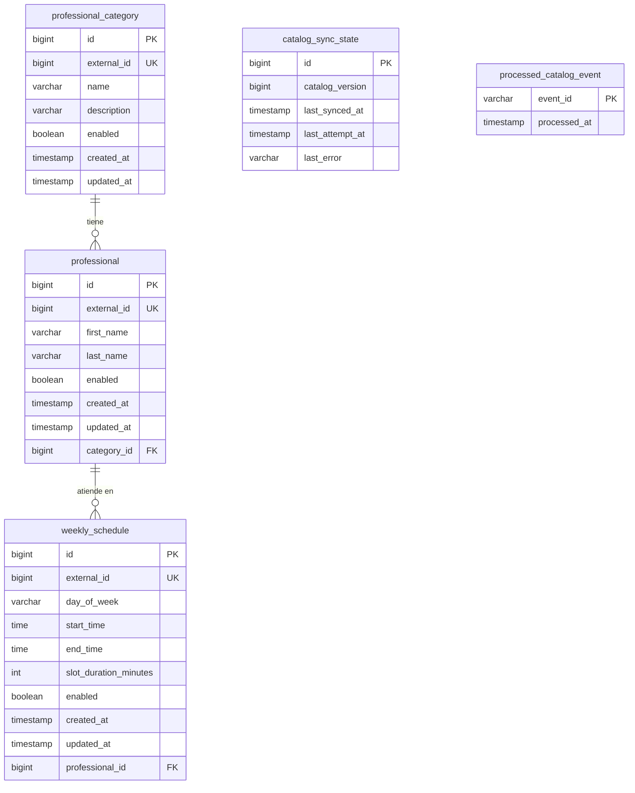

# Modelo de datos del catálogo

El catálogo tiene su propia base PostgreSQL. Ningún otro servicio la lee ni escribe: turnos
pide lo que necesita por la API ([api.md](api.md)). El esquema lo crea Liquibase al arrancar
(`src/main/resources/config/liquibase/`).

## De quién son los datos

| Tabla | Dueño | Qué guarda |
| --- | --- | --- |
| `professional_category` | Cátedra (copia) | Categorías o especialidades |
| `professional` | Cátedra (copia) | Profesionales |
| `weekly_schedule` | Cátedra (copia) | Horarios semanales de atención |
| `catalog_sync_state` | Catálogo | Versión de la copia y resultado de la última sincronización |
| `processed_catalog_event` | Catálogo | Avisos de Kafka ya procesados |

Las tres primeras son una **copia** de los datos de la cátedra: el servicio nunca los inventa
ni los modifica por su cuenta, solo los actualiza cuando sincroniza. Las dos últimas son
propias: sirven para saber hasta dónde está sincronizada la copia.

El catálogo no tiene tablas de usuarios. Los usuarios son del servicio de turnos
([decisiones.md](decisiones.md), puntos 3 y 8).

## Diagrama

## Tablas

### `professional_category`

| Columna | Tipo | Notas |
| --- | --- | --- |
| `id` | bigint | Id local (secuencia `sequence_generator`). |
| `external_id` | bigint | Id en la cátedra. Único. |
| `name` | varchar(255) | Nombre de la categoría. |
| `description` | varchar(1000) | Descripción. |
| `enabled` | boolean | Si está habilitada en la cátedra. |
| `created_at`, `updated_at` | timestamp | Fechas que manda la cátedra, en UTC. |

### `professional`

| Columna | Tipo | Notas |
| --- | --- | --- |
| `id` | bigint | Id local. |
| `external_id` | bigint | Id en la cátedra. Único. Es el que se usa para reservar. |
| `first_name`, `last_name` | varchar | Nombre y apellido. |
| `enabled` | boolean | Si está habilitado en la cátedra. |
| `created_at`, `updated_at` | timestamp | Fechas que manda la cátedra, en UTC. |
| `category_id` | bigint | FK a `professional_category`. Cada profesional tiene una categoría. |

Un profesional se puede reservar solo si él **y** su categoría están habilitados. Eso no se
guarda en una columna: se calcula al responder (`bookable` en la agenda, `enabled=true` en la
búsqueda).

### `weekly_schedule`

| Columna | Tipo | Notas |
| --- | --- | --- |
| `id` | bigint | Id local. |
| `external_id` | bigint | Id en la cátedra. Único. |
| `day_of_week` | varchar | `MONDAY` ... `SUNDAY`. |
| `start_time`, `end_time` | time | Hora de reloj, **sin zona horaria** ([decisiones.md](decisiones.md), punto 6). |
| `slot_duration_minutes` | int | Duración de cada turno. |
| `enabled` | boolean | Si el horario está habilitado en la cátedra. |
| `created_at`, `updated_at` | timestamp | Fechas que manda la cátedra, en UTC. |
| `professional_id` | bigint | FK a `professional`. |

Un profesional puede tener varios horarios, incluso varios el mismo día (por ejemplo, de 9 a
12 y de 15 a 18).

### `catalog_sync_state`

Tiene **una sola fila** (`id = 1`), que crea Liquibase vacía.

| Columna | Notas |
| --- | --- |
| `catalog_version` | Versión del catálogo de la cátedra que tiene la copia. `null` si nunca se sincronizó. |
| `last_synced_at` | Cuándo terminó bien la última sincronización. |
| `last_attempt_at` | Cuándo fue el último intento, haya salido bien o mal. |
| `last_error` | Por qué falló el último intento (hasta 1000 caracteres). `null` si salió bien. |

Es lo que muestra `GET /api/catalog/sync-status`.

### `processed_catalog_event`

| Columna | Notas |
| --- | --- |
| `event_id` | `eventId` del aviso `CatalogUpdated` de Kafka. Clave primaria. |
| `processed_at` | Cuándo se procesó. |

Si llega un aviso con un `eventId` que ya está en la tabla, se ignora. Aunque se procesara dos
veces no se rompería nada (la sincronización compara versiones contra Redis), pero así se
evita trabajo de más.

## Cómo cambian los datos

- **Nada se borra.** Si la cátedra deshabilita algo, llega con `enabled = false`. Si al cargar
  un snapshot falta algo que antes estaba, se marca `enabled = false` en la copia. Así no se
  pierden referencias y la búsqueda con `enabled=true` ya no lo muestra.
- Las filas se identifican por `external_id`: si ya existe se actualiza, si no se crea. Por
  eso cargar el mismo snapshot dos veces deja la base igual.
- La versión avanza de a una: cada versión de cambios se aplica en su propia transacción
  junto con el nuevo `catalog_version`. Si una falla, la copia queda bien en la anterior.

El detalle de cuándo se usa snapshot y cuándo cambios incrementales está en
[sincronizacion.md](sincronizacion.md).
