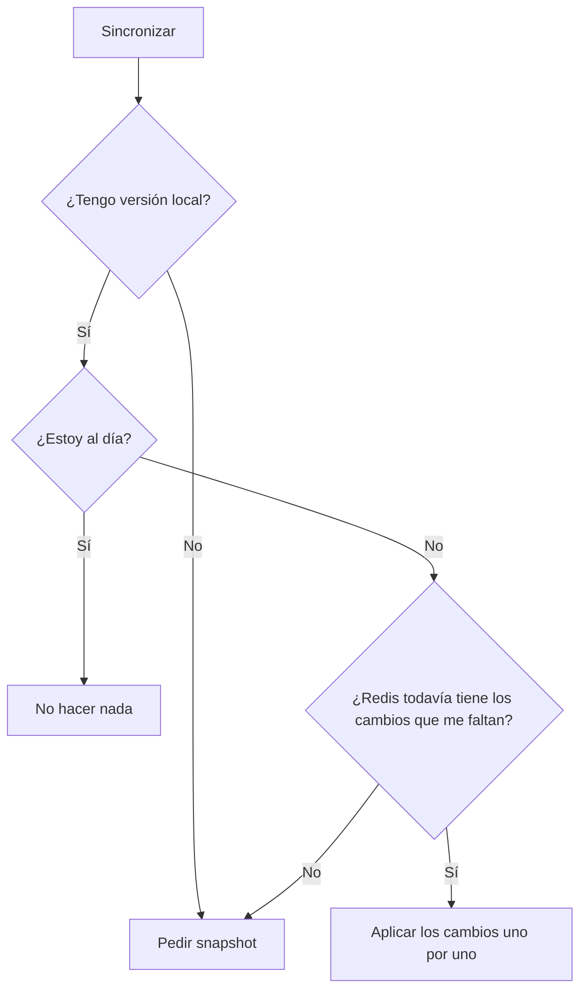
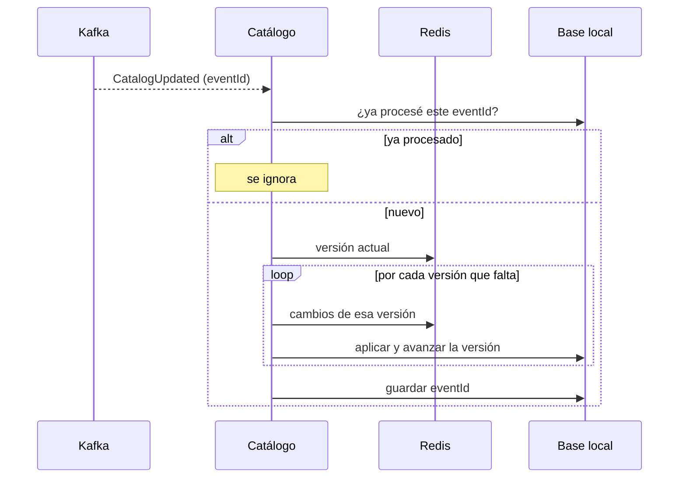

# Sincronización del catálogo

El servicio de catálogo tiene una copia propia de las categorías, profesionales y horarios de la cátedra. Las búsquedas se hacen siempre sobre esa copia, no contra el servidor de la cátedra.

Para mantenerla al día se usan tres cosas:

- **REST (snapshot):** trae el catálogo completo. Se usa cuando la base está vacía o cuando nos atrasamos demasiado.
- **Redis:** tiene la versión actual del catálogo y los cambios de cada versión. Se usa para actualizar de a poco.
- **Kafka:** solo avisa que hay una versión nueva (`CatalogUpdated`). No trae datos.

Como Kafka solo avisa, si se pierde un mensaje no se pierden datos. Basta con volver a comparar versiones.

## Cómo decide qué hacer

Cada vez que se sincroniza, se compara la versión local con la que dice Redis:



"¿Redis todavía tiene los cambios?" se responde así: la versión local tiene que ser mayor o igual a `oldest-available-version`. Por ejemplo, si estoy en la 3 y Redis solo guarda desde la 4, me falta un cambio y pido el snapshot (caso 18.2 de la referencia).

## Snapshot

Se usa en el primer arranque o cuando quedamos muy atrasados.

1. Se pide `GET /api/synchronization/snapshot`.
2. Se revisa que todo esté bien relacionado: cada profesional con una categoría que existe y cada horario con un profesional que existe.
3. Se guarda todo en **una sola transacción**. Si algo falla, no queda nada a medias.
4. Lo que teníamos y no vino en el snapshot no se borra: se marca `enabled = false`.
5. Se guarda la versión del snapshot como versión local.

## Cambios incrementales



Algunas decisiones:

- Cada versión se aplica en su propia transacción. Si la 6 sale bien y la 7 falla, la base queda bien en la 6 y la próxima vez sigue desde ahí.
- Las versiones se aplican en orden. Si se intenta aplicar una que no sigue a la actual, se corta con un error.
- El listener no usa el número de versión que trae el mensaje: siempre compara contra Redis. Así un mensaje viejo no puede hacer retroceder la copia.
- Los cambios en Redis traen solo IDs. Los datos de cada entidad se leen de su hash (`professionals`, etc.).

## Mensajes repetidos, perdidos o desordenados

Kafka puede entregar el mismo mensaje más de una vez. Por eso:

- Cada `eventId` procesado se guarda en la tabla `processed_catalog_event`. Si llega de nuevo, se ignora.
- Además, si una versión ya está aplicada, aplicarla otra vez no cambia nada.

| Qué pasa                      | Cómo se resuelve                                       |
| ----------------------------- | ------------------------------------------------------ |
| Llega un mensaje repetido     | Se ignora por el `eventId`                             |
| Llega un aviso viejo          | Ya estoy al día, no hace nada                          |
| Se pierde un aviso            | El próximo aviso aplica todas las versiones que falten |
| Me atrasé demasiado           | Se pide el snapshot                                    |
| La app estuvo apagada         | Sincroniza sola al arrancar                            |
| Falla Redis, la API o la base | Queda en el log y la versión no avanza                 |

Además, una sola sincronización corre a la vez: si Kafka y la tarea periódica disparan juntas, la segunda espera y, cuando entra, ya encuentra la copia al día.

## Respaldo periódico y estado

Si la sincronización que dispara un aviso de Kafka falla, ese aviso no se vuelve a leer. Para no depender del próximo aviso, cada 5 minutos (`CATEDRA_SYNC_INTERVAL`) se vuelve a comparar la versión local con Redis. Si no hay nada nuevo, no hace nada.

Cada intento, venga del arranque, de Kafka o de la tarea periódica, queda guardado en `catalog_sync_state` y se puede consultar:

```
GET /api/catalog/sync-status
```

```json
{
  "status": "OK",
  "catalogVersion": 1,
  "lastSyncedAt": "2026-10-28T18:55:10Z",
  "lastAttemptAt": "2026-10-28T18:55:10Z",
  "lastError": null
}
```

`status` vale `NOT_SYNCED` si todavía no hay versión local, `ERROR` si el último intento falló y `OK` en otro caso. Si falla, la copia local no se toca: se sigue buscando con la última versión buena.

## Dónde está en el código

Todo está en el paquete `sync` (ver [ADR 0001](adr/0001-sincronizacion-hexagonal.md)):

- `CatalogSyncService`: decide qué hacer (snapshot, cambios o nada).
- `CatedraRestAdapter`: pide el snapshot.
- `RedisCatalogChangeSource`: lee versiones y cambios de Redis.
- `JpaCatalogReplica`: guarda en PostgreSQL.
- `CatalogUpdatedListener`: escucha Kafka.
- `CatalogSyncOnStartup`: sincroniza al arrancar.
- `CatalogSyncScheduler`: sincroniza cada 5 minutos como respaldo.
- `RecordingCatalogSync`: envuelve la sincronización, guarda cómo terminó cada intento y evita que corran dos a la vez.

La versión local está en la tabla `catalog_sync_state`.

## Configuración y pruebas

Las URLs y credenciales van en variables de entorno (ver `.env.example`). El `.env` real no se sube.

Para correr los tests:

```bash
./mvnw verify
```

## Prueba contra la cátedra

- **23/10:** con la base vacía cargó el snapshot: versión 1, con 8 categorías, 24 profesionales y 44 horarios. Kafka quedó suscripto al topic asignado.
- **28/10:** con Redis apuntando a un puerto equivocado, la sincronización falla al conectarse (`Unable to connect to Redis`) y el estado pasa a `ERROR` sin tocar la copia. Con Redis bien configurado lee las versiones y ve que está al día. Al volver, el estado se recupera a `OK`.

La prueba de Redis del 23/10 no servía: en ese momento la lógica incremental todavía no estaba en `main` y el servicio no consultaba Redis, aunque el log decía lo mismo. Por eso se repitió forzando un error.
